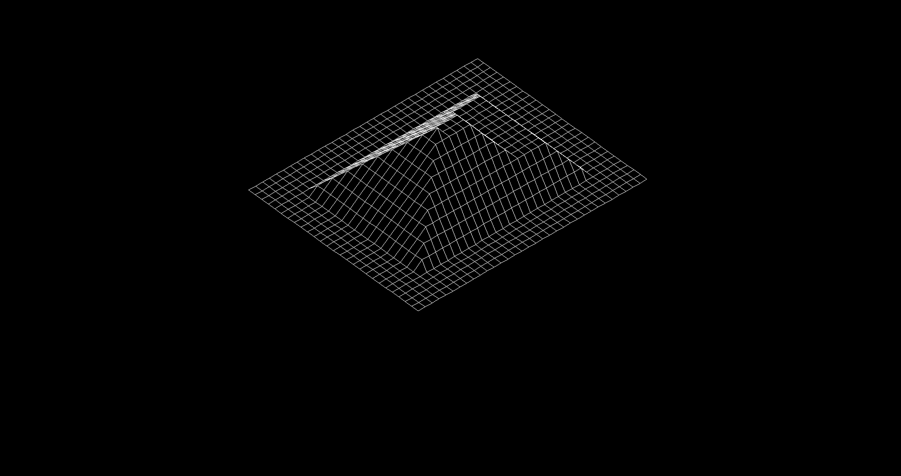

# fdf

As input, we have a map of numbers corresponding to the altitude of each point.
The aim is to display this map in an isometric projection.

For this task, I use a matrix rotation for the isometric projection, and I use the Bresenam algorithm for draw the lines.

Some dots may have a RGB code, so I manage colors for some maps.

